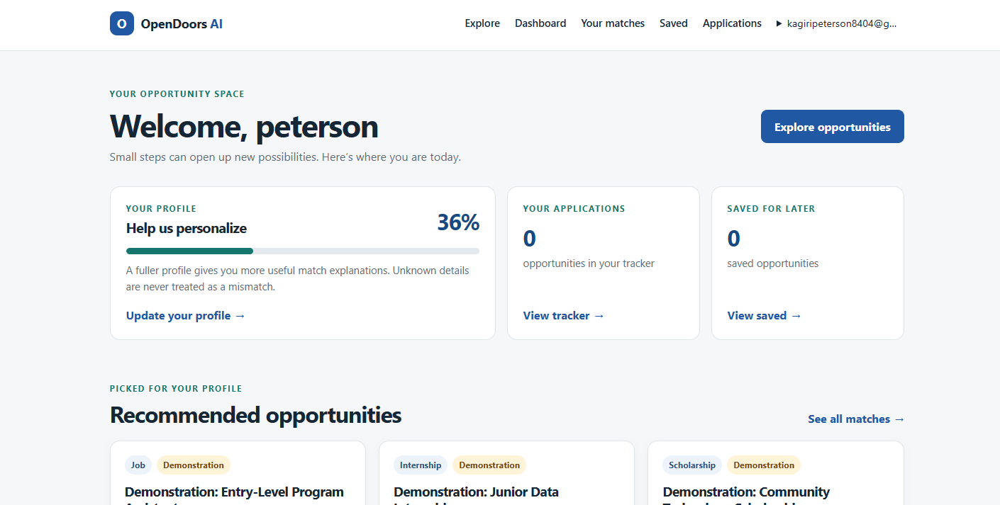
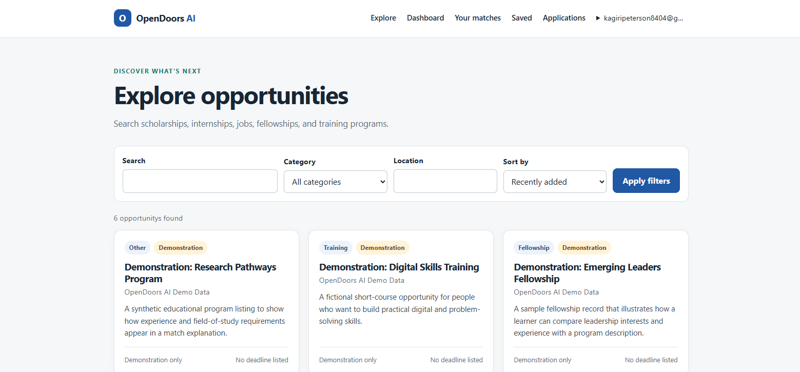
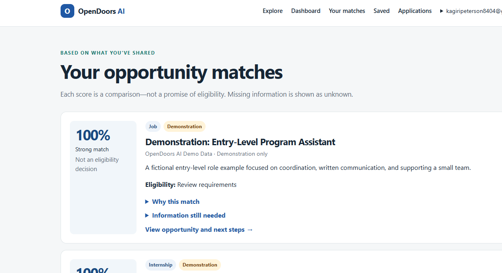
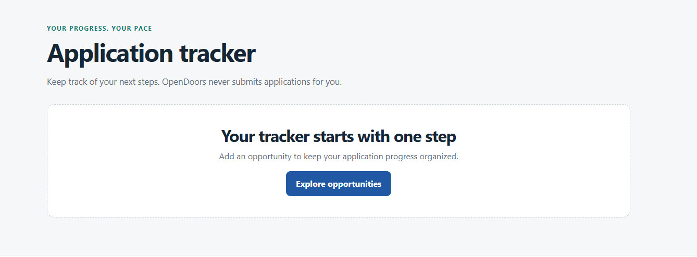
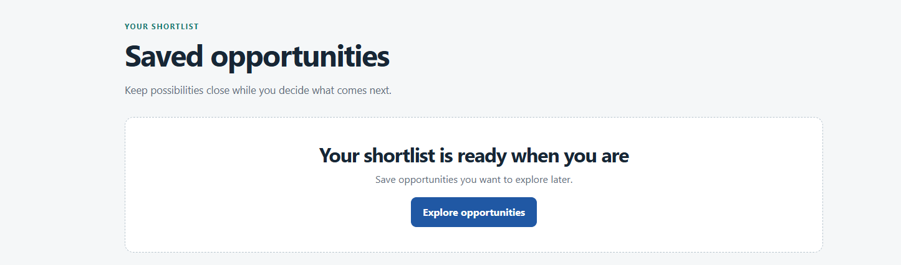

# OpenDoors AI

**Breaking barriers. Unlocking opportunities.**

OpenDoors AI is an accessible opportunity-discovery MVP for scholarships, internships, entry-level jobs, fellowships, educational programs, and training. It helps people organize their goals, compare published opportunities with their profile, understand what is known or missing, and track their own next steps.

## Problem and approach

Opportunity information is often scattered and difficult to compare. OpenDoors brings listings into one searchable catalogue and provides a deterministic, explainable profile comparison. Match scores are not eligibility decisions: missing information remains unknown, and only explicit unmet mandatory requirements are identified as potential disqualifiers.

## Features

- Email-based registration and session login/logout with Django password validation.
- Private seeker profiles, preferences, and optional CV upload (PDF/DOC/DOCX, maximum 5 MB).
- Searchable, filterable, paginated opportunity directory and Django Admin management.
- Deterministic, ranked matching with dimension-level scores, reasons, missing information, eligibility concerns, and next steps.
- Rule-based plain-language eligibility explanations when no AI provider is configured.
- Optional OpenAI-compatible explanation provider behind a dedicated service; provider output supplements but does not replace the listed requirements.
- User-scoped saved opportunities and application status tracking.
- Responsive, keyboard-accessible pages, visible focus, skip link, live feedback, semantic headings, and reduced-motion support.
- Clearly labeled synthetic demo data with no fabricated live organizations, deadlines, or application links.
- Session-authenticated REST API and generated OpenAPI schema.

## Architecture

| Area | Responsibility |
| --- | --- |
| `accounts` | Registration, session authentication, dashboard, profile/settings pages |
| `profiles` | Seeker profile model and private profile API |
| `opportunities` | Published opportunity catalogue, discovery UI, Admin, demo seed command |
| `matching` | Explainable scoring, optional AI abstraction, match/explanation APIs |
| `applications` | User-owned bookmarks and application tracking |
| `config` | Django settings, database/static deployment, URLs, WSGI/ASGI |
| `templates`, `static` | Server-rendered accessible frontend and responsive styles |

### Matching weights

Scores use the weighted average of available dimensions; missing dimensions are excluded rather than counted as zero. Current weights are skills 30, education 25, field of study 20, experience 15, location 10, and preferred category 10. The five suggested core dimensions retain their requested weights; category alignment is included as an additional preference signal, so all six known dimensions together have a total weight of 110 before normalization. Results are rounded to an integer from 0 to 100. Update `MATCH_WEIGHTS` in `matching/services.py` to tune them.

Education and experience are compared using ordered levels. Skills score the proportion of listed required skills present in the profile. Field and location comparisons are case-insensitive. An explicit requirement only disqualifies a profile when an opportunity administrator records a supported mandatory rule (`in` or `equals`) and the profile value conflicts. Unknown values request confirmation. A passed match never establishes legal or provider eligibility.

## Technology

- Python 3.11+ recommended; Django 5.2 LTS and Django REST Framework.
- SQLite for local development; PostgreSQL through `DATABASE_URL` for deployment.
- Django templates, HTML, CSS, and vanilla browser behavior.
- WhiteNoise and Gunicorn for a Render-compatible web service.
- Optional OpenAI-compatible chat-completions API via Python's standard library.

## Local setup

1. Install Python 3.11 or later and create/activate a virtual environment.
2. Install dependencies:

   ```powershell
   python -m venv .venv
   .\.venv\Scripts\Activate.ps1
   python -m pip install -r requirements.txt
   ```

3. Copy `.env.example` to `.env` and set a unique `SECRET_KEY`. Export variables in your shell or use your preferred environment-file loader; Django intentionally does not read `.env` automatically.
4. Initialize the database and create sample records:

   ```powershell
   python manage.py migrate
   python manage.py createsuperuser
   python manage.py seed_demo
   ```

5. Start the development server:

   ```powershell
   python manage.py runserver
   ```

Open `http://127.0.0.1:8000/`. Admin is at `/admin/`; all seeded opportunities are marked **Demonstration** and use no external application links or deadlines.

## Environment

Copy `.env.example` as a reference. Django does not load `.env` files itself: export values into the process environment or configure them in your deployment provider. Never put API keys or production secrets in browser JavaScript or commit them.

| Variable | Required when | Description |
| --- | --- | --- |
| `SECRET_KEY` | `DEBUG=false` | Unique secret of at least 50 characters. Production startup rejects the development fallback. |
| `DEBUG` | Always set in production | Defaults to `true`; set to `false` in production. |
| `ALLOWED_HOSTS` | Production/custom hosts | Comma-separated hostnames. Render's `RENDER_EXTERNAL_HOSTNAME` is also included automatically. |
| `DATABASE_URL` | Production | PostgreSQL connection URL. Empty uses local SQLite. |
| `CSRF_TRUSTED_ORIGINS` | Custom domains/proxies | Comma-separated trusted origins including `https://`; Render hostname is added automatically. |
| `SECURE_SSL_REDIRECT` | Production | Defaults to `true` when `DEBUG=false`. |
| `CACHE_BACKEND`, `CACHE_TABLE` | Production rate limits | Render uses the database cache; `createcachetable` runs during pre-deploy. |
| `EMAIL_ENABLED` | Optional | Defaults to `false`. When enabled, registration requires verification and password-reset mail is sent. |
| `EMAIL_HOST`, `EMAIL_PORT`, `EMAIL_HOST_USER`, `EMAIL_HOST_PASSWORD` | Outbound email | SMTP server settings. In local debug, no `EMAIL_HOST` selects Django's console email backend. |
| `EMAIL_USE_TLS`, `EMAIL_USE_SSL`, `EMAIL_TIMEOUT`, `DEFAULT_FROM_EMAIL` | Outbound email | SMTP transport and sender settings. TLS and SSL cannot both be enabled. |
| `ACCOUNT_RATE_LIMIT_ATTEMPTS`, `ACCOUNT_RATE_LIMIT_WINDOW_SECONDS` | Optional | Cache-backed limits for sensitive account actions. |
| `PASSWORD_RESET_TIMEOUT` | Optional | Password-reset token lifetime in seconds (default: 259200). |
| `AI_ENABLED` | Optional | Defaults to `false`; rule-based explanations remain available. |
| `AI_PROVIDER` | AI use | `openrouter` or `openai_compatible`. |
| `AI_API_KEY`, `AI_MODEL` | AI use | Server-side provider credential and model identifier. |
| `AI_BASE_URL`, `AI_TIMEOUT_SECONDS` | AI use | HTTPS API base and request timeout. OpenRouter defaults to `https://openrouter.ai/api/v1`; timeout defaults to 30 seconds. |
| `AI_SITE_URL`, `AI_SITE_NAME` | OpenRouter (optional) | Optional OpenRouter attribution headers. |
| `OPPORTUNITY_FEEDS_JSON`, `TRUSTED_OPPORTUNITY_SOURCE_HOSTS` | Ingestion | JSON feed registry and exact comma-separated HTTPS host allowlist. No source is configured by default. |
| `MEDIA_ROOT` | Local/private file storage | Local directory for uploaded CVs. |
| `FILE_STORAGE_BACKEND`, `FILE_STORAGE_OPTIONS_JSON` | Alternate storage | Django storage backend import path and JSON options for a future private object-storage adapter. |

When AI is disabled, explanations are labeled **Rule-based explanation**. With valid provider settings they are labeled **AI-assisted explanation**. A provider failure returns the deterministic explanation with a warning instead of pretending an AI response was produced. The listed opportunity requirements remain authoritative.

When AI is enabled, the provider receives profile details used for explanation (education, field, skills, experience, location preference, and interests) and opportunity description/requirements. CV files are never sent. Review the configured provider's data handling and retention terms first. Opportunity and profile text are treated as untrusted data; an LLM explanation does not change eligibility decisions.

### Manual OpenRouter verification

Use a staging service or local environment with a real, authorized OpenRouter key. Set `AI_ENABLED=true`, `AI_PROVIDER=openrouter`, `AI_API_KEY`, `AI_MODEL`, `AI_BASE_URL=https://openrouter.ai/api/v1`, and `AI_TIMEOUT_SECONDS=30` in the server environment, then restart the app. Keep the key out of source control, frontend settings, screenshots, and logs. Sign in, open a published opportunity, and select **Explain this opportunity to me**. A successful provider request is shown as **AI-assisted explanation**; a timeout, invalid key, quota, unavailable model, or provider outage should remain a clearly labeled rule-based fallback with a warning. Verify both a successful response and a failure path before a demo. Automated tests mock these responses; a real request has not been made for this project.

## Database and demo data

Migrations live in each model-owning app's `migrations/` folder. `seed_demo` is idempotent and creates six synthetic records. It does not create live deadlines, organizations, or application URLs.

```powershell
python manage.py migrate
python manage.py seed_demo
```

For production, set `DATABASE_URL` to PostgreSQL before running migrations. Do not use the demonstration records as live listings.

## Tests and checks

```powershell
python manage.py test
python manage.py check
python manage.py makemigrations --check --dry-run
```

The core suite covers authentication, profile updates, discovery and filters, deterministic matching, missing information, mandatory eligibility mismatches, AI provider behavior with mocked HTTP responses, email-token flows, feed imports, health checks, saved records, application statuses, and cross-user privacy. Run the optional browser and axe suite after installing `requirements-dev.txt` and the Playwright browser:

```powershell
python -m pip install -r requirements-dev.txt
python -m playwright install chromium
python manage.py test browser_tests
```

The browser journey exercises registration, profile editing, discovery/detail, matching, saving, application tracking, login, a narrow viewport, keyboard skip-link focus, reduced-motion mode, and axe checks against WCAG 2.x A/AA tags on exercised pages. Automated checks are not a WCAG certification or a substitute for manual keyboard, screen-reader, zoom, and assistive-technology testing.

## API

All API paths are under `/api/`. Session authentication is used for private endpoints; unsafe requests require a valid CSRF token. Opportunity list/detail endpoints are public and include only published records. Pagination uses page-number pagination (12 records by default).

| Method and path | Access | Purpose |
| --- | --- | --- |
| `POST /api/auth/register/` | Public, CSRF | Register and start a session |
| `POST /api/auth/login/` | Public, CSRF | Start a session |
| `POST /api/auth/logout/` | Authenticated, CSRF | End a session |
| `GET, PUT, PATCH /api/profile/` | Authenticated | Read/update current user's profile |
| `PUT, PATCH /api/profile/update/` | Authenticated | Alias for profile update |
| `GET /api/opportunities/?q=&category=&location=&ordering=deadline` | Public | Search/filter/paginate |
| `GET /api/opportunities/{id}/` | Public | Published opportunity details |
| `GET /api/matches/` | Authenticated | Ranked, paginated match results |
| `GET /api/matches/{opportunity_id}/` | Authenticated | One explainable match |
| `POST /api/matches/explanations/` | Authenticated | Explain with `{"opportunity_id": 1}` |
| `GET, POST /api/saved-opportunities/` | Authenticated | List/create current user's saved records |
| `DELETE /api/saved-opportunities/{id}/` | Authenticated | Remove an owned saved record |
| `GET, POST /api/applications/` | Authenticated | List/create application tracker records |
| `GET, PUT, PATCH, DELETE /api/applications/{id}/` | Authenticated | Manage an owned tracker record |
| `GET /api/schema/` | Public | OpenAPI schema |

Application statuses: `interested`, `preparing`, `applied`, `interview`, `accepted`, `rejected`, and `withdrawn`. User IDs are always assigned from the authenticated session, never accepted from API input.

## Optional email flows

Email is disabled by default. With `EMAIL_ENABLED=true`, new accounts are inactive until they follow the emailed verification link; Django's password-reset token generator provides expiring, single-use reset tokens. Sensitive actions use cache-backed limits and unknown password-reset addresses receive the same success response as known addresses.

For local testing, keep `DEBUG=true`, set `EMAIL_ENABLED=true`, and leave `EMAIL_HOST` empty. Django writes verification/reset emails to the development server console. For production, configure an authenticated SMTP service and `DEFAULT_FROM_EMAIL`, then enable email only after verifying delivery and sender-domain setup. If SMTP is unavailable, the application reports the delivery issue and exposes a resend flow; it does not claim delivery succeeded.

Manual verification: register with a controlled mailbox, follow the verification link, sign in, request a password reset, and use the reset link before its configured expiry. Confirm an unknown email receives the same reset confirmation page and verify that throttled requests do not send repeated mail. Use a staging SMTP account first; actual email delivery has not been tested here.

## Verified opportunity ingestion

The importer consumes a provider-approved normalized JSON feed; it does not scrape websites. Select a source only after confirming its terms permit ingestion and that it supplies trustworthy listing data. The registry and allowlist are intentionally empty by default.

Configure `OPPORTUNITY_FEEDS_JSON` as a JSON array with feed `id`, display `name`, and HTTPS `url`, for example:

```json
[{"id":"partner-feed","name":"Partner Feed","url":"https://feed.example.org/opportunities.json"}]
```

Add the feed's exact hostname to `TRUSTED_OPPORTUNITY_SOURCE_HOSTS`. Each response must be JSON shaped as `{"opportunities":[...]}`. Records require a stable `id`, title, organization, description, and supported category; optional normalized fields include location, eligibility requirements, required skills/education/field/experience, ISO `YYYY-MM-DD` deadline, application URL, opportunity type, and source URL. Application and source URLs must use HTTPS. The importer validates public DNS answers, disables redirects, enforces a 2 MB response/500 record/15-second request limit, rejects malformed or past-deadline listings, and records the source and collection time. These checks do not replace source review or a pinned network connection.

Start with a non-writing validation:

```powershell
python manage.py ingest_opportunities --feed partner-feed --dry-run
```

By default, validated new records are unpublished for Admin review. Only use `--publish` after confirming the source and records:

```powershell
python manage.py ingest_opportunities --feed partner-feed --publish
```

Imports are deduplicated by source identifier and title/organization; curated records are not overwritten. Source-managed records are updated on later runs, and records with expired deadlines are unpublished. The feed must be run on a schedule by an operator or external scheduler; no feed is configured, scheduled, or live-verified in this repository. Check each provider's terms and collection cadence before configuring it; source timestamps indicate collection time, not a guarantee that a provider's listing is current.

## Deployment (Render)

The included `render.yaml` defines a Django web service, PostgreSQL database, and a 1 GB persistent disk for private uploaded CVs. Render collects static files in the build step and runs migrations plus database-cache setup in the pre-deploy step. `/healthz/` checks database connectivity for the Render health check.

1. Push the repository to GitHub and create a Render Blueprint from the repository's `render.yaml`.
2. Review the service/database plans and region, then approve creation. Configure any custom domain in `ALLOWED_HOSTS` and add its `https://` origin to `CSRF_TRUSTED_ORIGINS`.
3. Keep the generated `SECRET_KEY` private; confirm `DEBUG=false`, HTTPS redirection, and the PostgreSQL `DATABASE_URL`.
4. Deploy and verify the Render logs, `https://<service-host>/healthz/`, registration, login, private profile pages, and Admin. No public deployment has been performed or verified as part of this repository work.
5. To initialize a demonstration catalogue, run `python manage.py seed_demo` from the Render Shell. Create an administrator only when needed:

```sh
python manage.py createsuperuser
python manage.py seed_demo
```

The seed command creates synthetic demo listings, not a demo user or live opportunities. Use the registration page for the demo flow, complete a profile, explore listings, review matches, save an opportunity, and update its application status.

### CV storage and backups

CV uploads are limited to PDF/DOC/DOCX and 5 MB, checked for expected file signatures/container entries, saved under a UUID-based user-specific path, and served only through an authenticated, non-cacheable download view. Users can remove the uploaded file from their profile. This is format validation, not malware scanning.

The configured Render disk is persistent across deploys but attached to one service instance; it is not shared object storage, not a multi-instance scaling solution, and does not provide an independent backup/retention policy for this app. Before accepting real CVs, define an encrypted backup and recovery process, retention/deletion policy, and private object-storage backend. The settings expose Django's `FILE_STORAGE_BACKEND` and `FILE_STORAGE_OPTIONS_JSON` hooks, but no cloud storage provider or backup job is installed/configured. Do not copy uploads to a public/static directory.

### Operational visibility and launch checks

Render's health check verifies the app can reach its database. Use Render logs for deployment and request troubleshooting; this project does not currently integrate error reporting, metrics, alerting, an uptime monitor, or an audit-log service. Configure those operational controls before relying on the service for production workloads.

Before a public demo, verify:

- [ ] Render deployment succeeds; `/healthz/` returns `200` and `{"status":"ok"}`.
- [ ] HTTPS redirect, host allowlist, secure cookies, CSRF origin, and PostgreSQL are correct.
- [ ] A real registration/login/profile/edit/discovery/match/save/tracker journey works on the deployed host.
- [ ] SMTP delivery and expiring verification/reset links work, if `EMAIL_ENABLED=true`.
- [ ] A real OpenRouter explanation succeeds, if AI is enabled; otherwise show the honest rule-based explanation.
- [ ] A selected feed is permitted by its source, passes dry-run and Admin review, and its freshness is monitored.
- [ ] CV storage, deletion, backup, restore, and retention decisions are tested before accepting real documents.
- [ ] Manual keyboard, screen-reader, contrast, zoom, and mobile checks complement the automated browser/axe tests.
- [ ] Monitoring, incident contact, and recovery steps are known to the demo operator.

## Local development and demo

```powershell
python -m venv .venv
.\.venv\Scripts\Activate.ps1
python -m pip install -r requirements.txt
python manage.py migrate
python manage.py seed_demo
python manage.py runserver
```

Browse to `http://127.0.0.1:8000/`. Register a personal account; complete the profile to improve matches. Seeded opportunities are synthetic, labeled Demonstration, and do not claim real organizations, deadlines, or application links. Do not use shared demo passwords or real personal CVs in a public presentation.

## Screenshots
### Dashboard



### Explore opportunities



### Your matches



### Your applications



### Your saved applications



## Current limitations and next steps

- No Render deployment, production PostgreSQL connection, real SMTP delivery, real OpenRouter request, or configured live opportunity feed has been verified.
- Email verification and password reset are implemented but disabled by default until SMTP is configured.
- The optional AI path is covered with mocked provider tests; credentials/model availability and provider data-retention behavior still require manual verification.
- No production feed source is selected. Imported opportunities need source permission, operational scheduling, freshness monitoring, and human review.
- CV storage is local filesystem storage on the single-instance Render persistent disk. Object storage, malware scanning, independent backups, automated retention, and restore testing remain future production work.
- The browser/axe suite covers the tested pages and actions, but automated accessibility scans are not certification; manual assistive-technology testing remains necessary.
- Basic database health checking is present; production error monitoring, metrics, alerting, and uptime monitoring are not configured.
- Account deletion, provider-specific feed adapters, additional user research, and a demo video workflow remain future work.

## Hackathon presentation materials

Use the five committed screenshots in `docs/screenshots/` for the dashboard, Explore, Matches, Applications, and Saved pages. A short demo can follow the Local development and demo flow above; pause on the opportunity's Demonstration label and the match explanation to clarify that scores are not eligibility determinations.
